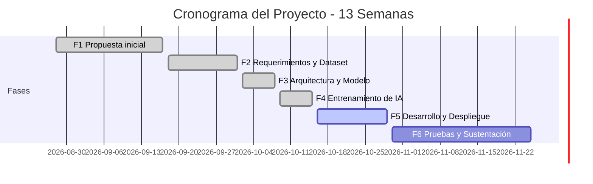

<div align="center">
  <h1> Clasificador de Residuos IA </h1>
  <p>PROTOTIPO WEB PARA LA CLASIFICACIÓN DE RESIDUOS MEDIANTE RECONOCIMIENTO DE IMÁGENES E INTELIGENCIA ARTIFICIAL
.</p>

  <!-- Badges / Insignias -->
  <p>
    
    
    
    
    
    
    
  </p>
</div>

---
## Link web:https://ia-clasificador-de-residuos.vercel.app/

## 📋 Tabla de Contenidos
1. [Descripción del Proyecto](#-descripción-del-proyecto)
2. [Características Principales](#-características-principales)
3. [Arquitectura y Tecnologías](#-arquitectura-y-tecnologías)
4. [ Deep Dive: Entrenamiento del Modelo de IA](#-deep-dive-entrenamiento-del-modelo-de-ia)
5. [Cronograma del Proyecto (Roadmap)](#️-cronograma-del-proyecto-roadmap)
6. [Despliegue en la Nube](#-despliegue-en-la-nube)
7. [Ética, Privacidad y Normativa](#-ética-privacidad-y-normativa)
8. [Autores](#-autores)

---

## 🌱 Descripción del Proyecto
El **Clasificador de Residuos IA** es una aplicación web Full-Stack que permite a los usuarios identificar el tipo de residuo que tienen en sus manos (biológicos, metal, cartón, papel o plástico) utilizando la cámara de su computador o subiendo una fotografía. 

El sistema procesa la imagen en el backend mediante un modelo de Deep Learning y devuelve la categoría predicha junto con su nivel de confianza y el color de la caneca correspondiente según la normativa colombiana.

## ✨ Características Principales
- **Captura en tiempo real:** Integración con la API `MediaDevices` para usar la cámara web.
- **Carga de archivos:** Opción alternativa para subir imágenes locales.
- **Sistema de Confianza:** Si la IA predice con menos del 60% de seguridad, el sistema despliega una alerta amarilla advirtiendo al usuario que verifique manualmente.
- **Privacidad por diseño:** Las imágenes se procesan en memoria volátil y nunca se almacenan en disco (Cumplimiento de la Ley 1581 de 2012).
- **Despliegue Serverless/Cloud:** Backend contenerizado en Docker y Frontend estático en CDN.

## 🏗️ Arquitectura y Tecnologías
El proyecto sigue una arquitectura Cliente-Servidor separada:

- **Frontend:** React (Vite), Tailwind CSS, Axios, `react-webcam`.
- **Backend:** Python 3.12, FastAPI, Uvicorn, Docker.
- **Inteligencia Artificial:** TensorFlow/Keras 2.21, MobileNetV2 (Transfer Learning), OpenCV/Pillow.
## 📁 Estructura del Proyecto
```text
PROYECTO_IA/
├── backend/               # Código fuente del servidor (FastAPI)
│   ├── app/               # Módulos de la API
│   ├── models/            # Modelo entrenado (.keras)
│   ├── Dockerfile         # Configuración para Render
│   └── requirements.txt   # Dependencias de Python
└── frontend/              # Código fuente de la interfaz (React)
    ├── src/               # Componentes y lógica
    └── package.json       # Dependencias de Node.js
```
## 🧠 Deep Dive: Entrenamiento del Modelo de IA

Esta sección documenta el proceso técnico de construcción del modelo de Visión por Computadora.

### 1. Dataset y Preprocesamiento
- **Fuente:** Kaggle.
- **Total de imágenes:** 5.973 (5 clases: `biological`, `cardboard`, `metal`, `paper`, `plastic`).
- **Partición:** 
  - Entrenamiento: 4.181 imágenes (70%)
  - Validación: 896 imágenes (15%)
  - Prueba: 896 imágenes (15%)
- **Aumentación de Datos (Data Augmentation):** Rotación (±20°), volteo horizontal, zoom (15%), y variación de brillo. Esto ayuda a que el modelo no memorice las imágenes (evita el sobreajuste).
- **Manejo del Desbalance:** Se calcularon **Pesos de Clase** . La clase `biological` tenía menos imágenes (699), por lo que sus errores pesaron más (1.71) durante el entrenamiento para equilibrar el aprendizaje.

### 2. Arquitectura y Hiperparámetros
Se utilizó **MobileNetV2** preentrenado en ImageNet, adaptando su capa de salida a nuestras 5 clases.
- **Fase 1 (Feature Extraction):** Base convolucional congelada. 
  - *Optimizador:* Adam (LR = 1e-3)
  - *Épocas:* 10
  - *Batch Size:* 32
- **Fase 2 (Fine-Tuning):** Descongelamiento de las últimas 30 capas de la red base.
  - *Optimizador:* Adam (LR = 1e-5)
  - *Épocas:* 10
- **Callbacks:** `EarlyStopping` (paciencia de 5 épocas) para detener el entrenamiento si el modelo dejaba de mejorar en validación.

### 3. Resultados y Métricas 
- **Accuracy Global:** ~72%
- **F1-Macro:** 0.72
- **Matriz de Confusión:** El modelo es altamente preciso identificando plástico (F1: 0.78) y biológicos (F1: 0.83). Presenta confusiones lógicas entre **cartón y papel** (texturas visuales similares) y entre metal y plástico.
- **Nota sobre Limitaciones:** Durante las pruebas reales, se detectó *Domain Shift* (el modelo se confunde con fondos oscuros o texturas atípicas). Por ello, se implementó un umbral de rechazo: si la confianza es < 60%, la app web muestra una alerta al usuario.

## 🗺️ Cronograma del Proyecto 

El proyecto tiene una duracion de  **13 semanas** (28 de agosto al 25 de noviembre). 

### Gráfico 

## ☁️ Despliegue en la Nube

El proyecto está preparado para producción usando servicios gratuitos:

**Backend (Render):** Se despliega utilizando un `Dockerfile (Python 3.12-slim)`. Nota: El plan gratuito de Render `"duerme"` el servicio tras 15 min de inactividad, tardando hasta 60s en la primera petición.

**Frontend (Vercel):** Se despliega automáticamente mediante integración continua conectada a este repositorio. Vercel genera HTTPS automático, lo cual es obligatorio para que los navegadores permitan el acceso a la cámara web (`getUserMedia`).

## 🧪 Pruebas y Validación (Testing)

Para garantizar la calidad del sistema, se ejecutó un exhaustivo plan de pruebas sobre 75 imágenes de validación (15 por cada clase) extraídas del dataset original, asegurando que el modelo no las hubiera visto durante el entrenamiento.

### 🤖 1. Pruebas Automatizadas de la API (Backend)

Para garantizar que el servidor (FastAPI) sea robusto, seguro y no se caiga ante peticiones mal formadas, se implementó una suite de pruebas automatizadas utilizando **`pytest`** y el **`TestClient`** de FastAPI .


#### Casos de Prueba Evaluados

| ID | Endpoint / Caso | Descripción | Resultado Esperado | Estado |
| :--- | :--- | :--- | :--- | :--- |
| **A1** | `GET /docs` | Disponibilidad de la documentación (Swagger UI). | `200 OK` y HTML válido. | ✅ PASÓ |
| **A2** | `POST /predict` (Válido) | Envío de una imagen real para clasificación. | `200 OK` con JSON (clase y confianza). | ✅ PASÓ |
| **A3** | `POST /predict` (Sin archivo) | Petición vacía al endpoint de inferencia. | Error de validación `422 Unprocessable Entity`. | ✅ PASÓ |
| **A4** | `OPTIONS /predict` | Validación de políticas CORS (para React en Vercel). | `200 OK` con cabecera `Access-Control-Allow-Origin`. | ✅ PASÓ |
| **Extra** | `GET /health` & `/model-info` | Verificación de estado del servidor y metadatos del modelo. | `200 OK`. | ✅ PASÓ |


### 📊 2. Resultados del Modelo de IA 
El modelo demostró una capacidad de generalización sólida a pesar del desbalance de datos original (donde la clase `biological` tenía menos muestras). Gracias al uso de pesos de clase durante el entrenamiento, se obtuvieron los siguientes resultados:

| Métrica | Valor Obtenido | Criterio de Aceptación |
| :--- | :--- | :--- |
| **F1-Macro Global** | **0.7595** | ≥ 0.70 (Superado) |
| **Accuracy (Exactitud)** | **76%** | - |
| **Latencia (CPU)** | **44.4 ms** (p95) | < 2000 ms (Superado) |


### 🛡️ 3. Pruebas de Robustez 
Se evaluó la resiliencia del modelo aplicando transformaciones a las imágenes para simular condiciones del mundo real:

| Condición de la Imagen | F1-Macro | Impacto | Análisis |
| :--- | :--- | :--- | :--- |
| **Original** | 0.7595 | - | Línea base del modelo. |
| **Oscura (Brillo 40%)** | 0.6867 | -7.28 pts | Dependencia de contrastes y bordes. |
| **Girada 90°** | 0.7237 | -3.58 pts | Alta invariancia espacial (capas convolucionales). |
| **Baja Resolución** | 0.4268 | -33.27 pts | La pérdida de texturas finas (letras, reflejos) afecta gravemente la predicción. |

### ⚡ 4. Latencia End-to-End 
Mediante Chrome DevTools, se midió el tiempo real que percibe el usuario al usar la app en producción:
*   **Cold Start (Primer arranque):** ~90 segundos. Ocurre porque el servicio en la nube (Render) "duerme" por inactividad y TensorFlow debe cargar el modelo .
*   **Peticiones en caliente:** **~2.5 segundos** promedio. Este tiempo incluye la transferencia de la imagen, la inferencia en el backend y el renderizado del resultado en React.

### 🚀 5. Pruebas de Carga y Estrés
Se utilizaron herramientas como **Locust** y scripts de **ráfagas concurrentes** (Python) para determinar los límites del backend (FastAPI):

*   **Locust (Carga Continua):** 
    *   *20 usuarios simultáneos:* Latencia de 199 ms, 0% de fallos.
    *   *50 usuarios simultáneos:* Latencia de 1.2 segundos, 0% de fallos. El RPS (peticiones por segundo) se estabilizó en 15.4, demostrando que la CPU local es el cuello de botella, pero el servidor **nunca colapsó**.
*   **Prueba de Ráfagas (Envíos masivos simultáneos):**
    *   Se enviaron lotes de 5, 20 y 50 imágenes exactamente al mismo tiempo.
    *   **Resultado:** El sistema procesó el **100% de las imágenes exitosamente (0 fallos)** en todos los lotes. El tiempo de respuesta por imagen aumentó a ~3.2 segundos en ráfagas altas debido al encolamiento del procesador, pero la arquitectura asíncrona de FastAPI demostró una estabilidad absoluta.

### 🖥️ 6. Pruebas Funcionales de Frontend (UI/UX)
*   **Flujo Exitoso:** La interfaz renderiza correctamente las etiquetas en español, el porcentaje de confianza y aplica el color de la caneca correspondiente (ej. Verde para Biológicos, Blanco para Plástico).
*   **Resiliencia (Manejo de Errores):** Al apagar el servidor intencionalmente, el frontend **no colapsa**; muestra una ventana modal amigable indicando *"Error: No se pudo conectar con el servidor"*.
*   **Transparencia:** Se muestra un panel con las probabilidades de cada clase, y si la confianza es < 60%, el sistema advierte al usuario para que verifique manualmente.

*(Los scripts de prueba utilizados, como `evaluar_modelo.py`, `test_concurrencia.py`,`test_robustez.py` y la configuración de `pytest`, están disponibles en la raíz del repositorio).*

## 🛡️ Ética, Privacidad y Normativa

Este proyecto académico esto  diseñado bajo  principios éticos y legales:

**No Almacenamiento (Privacidad):** Las imágenes capturadas se procesan en memoria (`BytesIO`) y se destruyen tras la inferencia, en cumplimiento de la Ley 1581 de 2012 (Protección de Datos Personales).

**Transparencia Algorítmica:** El sistema muestra las probabilidades en tiempo real y advierte si la confianza es menor al 60%, evitando la "ceguera" del usuario ante errores de la IA.

**Normativa Ambiental:** Los colores de las canecas mostrados en el frontend están alineados con la Resolución 2184 de 2019 (Código de Colores Nacional: Verde para residuos orgánicos aprovechables, Blanco para residuos aprovechables).

## 👨‍💻 Autores
José Camilo Oyola

Juan David Villa

Juan Esteban Caucayo

**Institución:** Universidad Central - Facultad de Ingeniería y Ciencias Básicas
**Director del Proyecto:** Elias Buitrago Bolivar
**Año:** 2026


